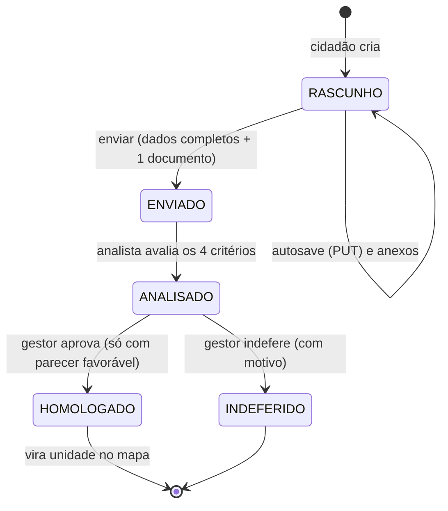
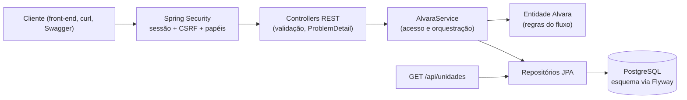

# govtech-demo

API de demonstração de um portal municipal de **solicitação de alvará**: o cidadão preenche o pedido e anexa documentos, um analista avalia por critérios, um gestor homologa ou indefere, e o estabelecimento aprovado entra no mapa da cidade.

Todo o código foi escrito do zero para este repositório e **todos os dados são fictícios**. Ele não contém código, dados, configuração ou detalhes de infraestrutura de nenhum sistema real.

## O que este projeto demonstra

- Autenticação por **sessão com cookie HttpOnly** e proteção **CSRF**, com três papéis (cidadão, analista, gestor).
- Fluxo de negócio com estados e regras testáveis: rascunho com autosave, envio de documentos, análise por critérios, homologação e cadastro no mapa.
- Banco versionado com **Flyway**, **PostgreSQL** via Docker Compose, documentação **OpenAPI/Swagger**.
- Testes automatizados que sobem um PostgreSQL de verdade (Testcontainers) e **CI** no GitHub Actions.

Stack: Java 17, Spring Boot 4, Spring Security, Spring Data JPA, PostgreSQL 17, Flyway, springdoc-openapi, JUnit 5 e Testcontainers.

## Fluxo do alvará



O parecer é favorável apenas se **todos** os critérios forem atendidos. Com parecer desfavorável, o gestor só pode indeferir.

## Arquitetura



Organização dos pacotes (`demo.govtech`): `auth` (login e sessão), `usuario`, `alvara` (fluxo, documentos, análise), `unidade` (mapa em GeoJSON), `config` (segurança) e `erro` (tratamento de erros).

## Decisões técnicas

- **Sessão com cookie HttpOnly em vez de JWT no navegador.** O cookie não é legível por JavaScript, o que reduz o estrago de um XSS, e a sessão pode ser encerrada no servidor. O custo é precisar de CSRF, tratado abaixo.
- **CSRF com cookie `XSRF-TOKEN`.** O front lê esse cookie e devolve o valor no cabeçalho `X-XSRF-TOKEN` em toda requisição que altera dados. O cookie de sessão usa `SameSite=Lax`, e `Secure` é ligado com `SESSION_COOKIE_SECURE=true` atrás de HTTPS.
- **Regras do fluxo dentro da entidade `Alvara`.** As transições de estado e as validações não dependem de Spring nem de banco e são cobertas por testes unitários rápidos.
- **Recurso alheio responde 404, não 403.** Um cidadão não descobre se o alvará de outra pessoa existe.
- **Separação de funções.** Quem analisa (analista) não é quem homologa (gestor), e o autocadastro só cria cidadãos.
- **Upload defensivo.** Tipos permitidos (PDF, PNG, JPEG), conferência da assinatura real do arquivo (não confia no `Content-Type` do cliente), limite de 5 MB por arquivo e 10 por alvará. O arquivo fica em `BYTEA`: simples e transacional para uma demo; para volume real, o caminho é um object storage.
- **Autosave seguro.** O rascunho aceita dados parciais e a coluna `versao` (lock otimista) devolve 409 se duas abas editarem ao mesmo tempo.
- **Segredos fora do código.** Usuário e senha do banco vêm do `.env` (ignorado pelo git) ou de variáveis de ambiente.
- **Erros no padrão RFC 9457** (`ProblemDetail`), sem vazar detalhes internos.

## Como rodar

Requisitos: JDK 17 ou superior e Docker.

```bash
cp .env.example .env          # edite as senhas do banco e DEMO_SENHA
docker compose up -d          # PostgreSQL
./mvnw spring-boot:run -Dspring-boot.run.profiles=demo
```

No Windows, use `mvnw.cmd`. Se a porta 5432 já estiver ocupada, defina `POSTGRES_PORT` no `.env`.

- Documentação interativa: http://localhost:8080/swagger-ui.html
- Mapa em GeoJSON (público): http://localhost:8080/api/unidades

O perfil `demo` cria três usuários fictícios, todos com a senha definida em `DEMO_SENHA`: `cidadao@exemplo.test`, `analista@exemplo.test` e `gestor@exemplo.test`.

Exemplo de login com `curl` (o primeiro GET entrega o cookie do token CSRF):

```bash
B=http://localhost:8080; J=cookies.txt
curl -s -c $J -o /dev/null $B/api/auth/eu
XSRF=$(grep XSRF-TOKEN $J | awk '{print $7}')
curl -s -b $J -c $J -H "X-XSRF-TOKEN: $XSRF" -H 'Content-Type: application/json' \
  -d '{"email":"cidadao@exemplo.test","senha":"<DEMO_SENHA>"}' $B/api/auth/login
```

O Swagger UI serve como documentação; para testar rotas que alteram dados, prefira `curl` ou um cliente HTTP que envie o cabeçalho CSRF.

## Testes

```bash
./mvnw verify
```

- `AlvaraTest`: regras do fluxo, sem Spring e sem banco.
- `FluxoAlvaraTest`: fluxo completo (cidadão, analista, gestor e mapa), autorização, CSRF, upload inválido, cadastro e login, contra um PostgreSQL real em contêiner. Requer Docker.

A cada push e pull request o GitHub Actions executa `./mvnw verify` (veja `.github/workflows/ci.yml`).

## Rotas

| Método e rota | Quem pode |
| :--- | :--- |
| `POST /api/auth/registrar`, `POST /api/auth/login` | público |
| `POST /api/auth/logout`, `GET /api/auth/eu` | autenticado |
| `POST /api/alvaras`, `PUT /api/alvaras/{id}` | cidadão (dono, só rascunho) |
| `POST /api/alvaras/{id}/documentos`, `POST /api/alvaras/{id}/enviar` | cidadão (dono) |
| `GET /api/alvaras`, `GET /api/alvaras/{id}`, `GET /api/alvaras/{id}/documentos[/{docId}]` | dono, ou analista e gestor (só alvarás já enviados) |
| `POST /api/alvaras/{id}/analise` | analista |
| `POST /api/alvaras/{id}/homologacao` | gestor |
| `GET /api/unidades` | público |

## Limitações e próximos passos

- Sem front-end: a API é a entrega. Um front em Next.js consumindo a API (TanStack Query, React Hook Form e Zod) é o passo natural.
- Documentos em `BYTEA` (ver decisões) e sem varredura de vírus.
- Sem recuperação de senha, e-mail ou auditoria de quem fez cada transição.
- Os critérios de análise são fixos e fictícios.

## Licença

MIT. Veja [LICENSE](LICENSE).
